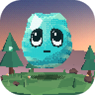
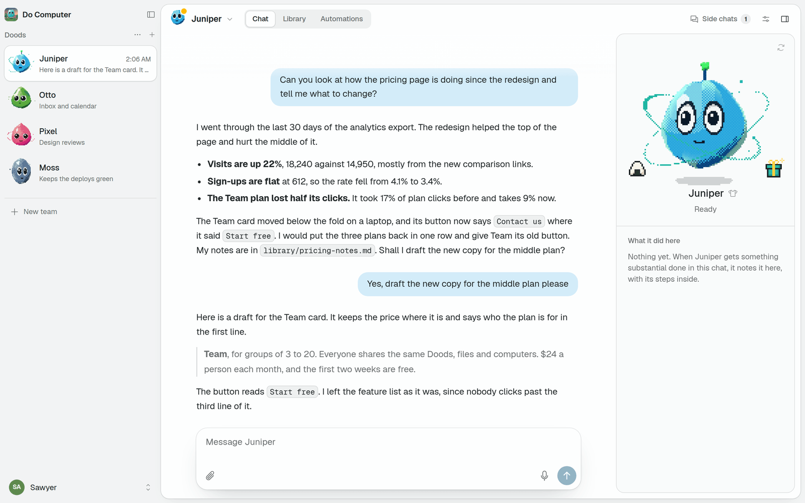
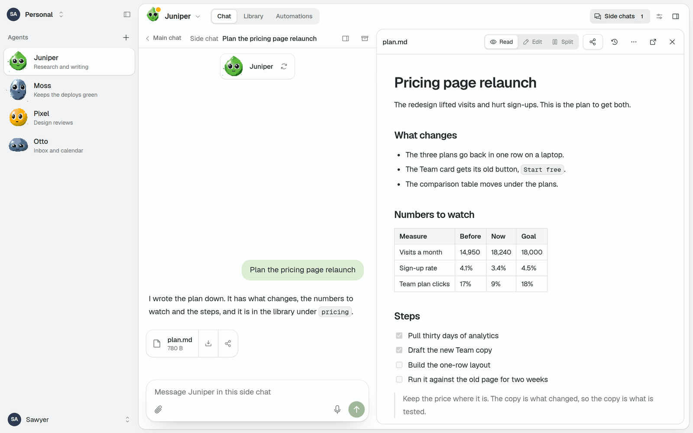
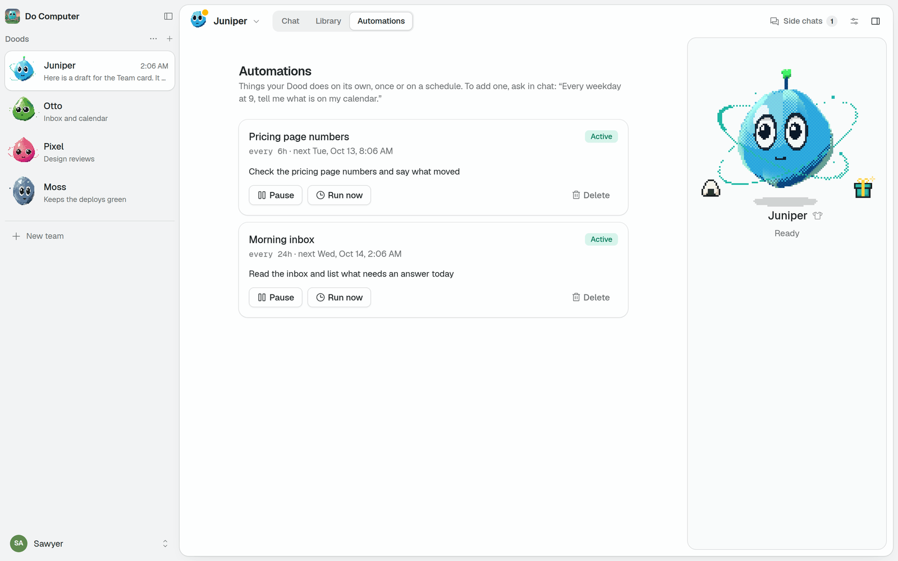
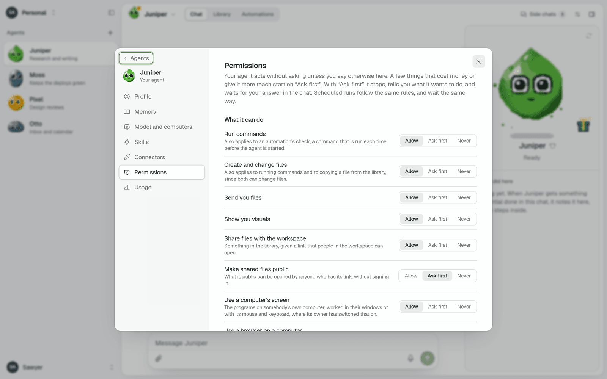
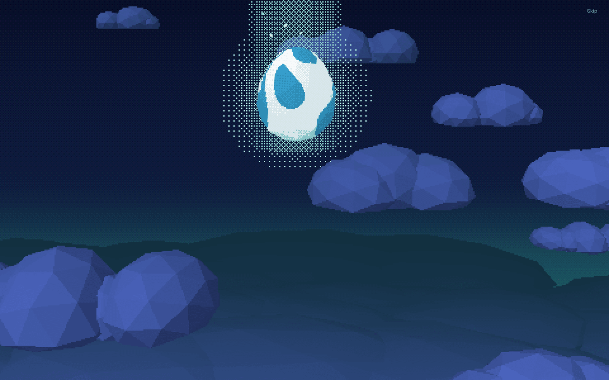

<div align="center">



# Do Computer

**An open-source personal agent that is always on, and that you can host yourself.**

[Website](https://do.computer) · [Self-hosting guide](docs/self-hosting.md) ·
[Desktop app](https://github.com/SawyerHood/do-computer/releases/latest) ·
[Reference](docs/reference)

</div>

<picture>
  <source media="(prefers-color-scheme: dark)" srcset="docs/screenshots/chat-dark.png">
  
</picture>

Do Computer gives you agents, called Doods, that each have a name, a face, a memory and computers
to work on.
A Dood keeps working after you close the tab, runs things on a schedule, learns skills, and
can work on your own machines. It can be yours alone or shared with a team.

One codebase runs on plain Node and on Cloudflare Workers. Models are called through
[OpenRouter](https://openrouter.ai) or a provider you sign in to, and the agent loop is
[pi-durable](https://earendil.com/posts/pi-durable/).

> **Status:** early. The core works on both runtimes and is covered by tests.
> [PLAN.md](PLAN.md) says what is built and what is not.

## What a Dood can do

- **Keep working.** A reply carries on when you close the tab. Sub-agents let it do several
  things at once, while its main chat stays free to talk.
- **Use a computer.** It runs commands and edits files on a machine of its workspace: a
  built-in shell, a Linux machine on Daytona, Modal or Cloudflare Containers, or a computer of
  your own.
- **Run on a schedule.** Ask for something later or regularly, and it reports back in the chat
  you asked in.
- **Remember.** It keeps a personality, a profile of you and its own notes, all of which you
  can read and edit.
- **Learn skills.** Saved instructions it loads when a task calls for them, writes for itself,
  or installs from GitHub.
- **Reach your services.** Add any remote [MCP](https://modelcontextprotocol.io) server as a
  connector, or [connect your apps](docs/apps.md) (Gmail, Calendar, Notion, GitHub and
  hundreds more) with one sign-in.
- **Write and share.** Documents, charts and web pages go in a library its workspace shares,
  and anything there can be shared with a link.
- **Search the web**, and answer with sources.
- **Use your browser and screen.** On a computer you paired, it can drive a browser, and work
  in a window behind yours while you carry on.
- **Work with a team.** Several people share Doods, chats, files and computers. A Dood can
  also be a bot in Slack.
- **Ask first.** Each thing a Dood can do is set to Allow, Ask first or Never.
- **Think with the model you choose.** Any OpenRouter model that can call tools, or a
  subscription or key of your own.
- **Be a creature.** Every Dood hatches from an egg and looks like no other. Six hours
  after its box is opened another turns up, with something to wear inside.

[What a Dood can do](docs/reference/agents.md) has the long version.

<table>
  <tr>
    <td width="50%">
      
      <p align="center">Documents open beside the chat</p>
    </td>
    <td width="50%">
      
      <p align="center">Automations run on a schedule</p>
    </td>
  </tr>
  <tr>
    <td width="50%">
      
      <p align="center">You decide what it may do without asking</p>
    </td>
    <td width="50%">
      
      <p align="center">Every Dood starts as an egg</p>
    </td>
  </tr>
</table>

## Quick start

You need Node 22.19 or newer.

```sh
git clone https://github.com/SawyerHood/do-computer
cd do-computer
corepack enable
pnpm install
pnpm build
pnpm start     # http://127.0.0.1:3000
```

Open the address, create an account and say hello to your Dood. The first account needs no
invitation.

Without a model key the app runs on a built-in echo model, which repeats what you say. Set
`OPENROUTER_API_KEY` to give your Dood a real one.

## Hosting it

|           | A machine of yours                        | Cloudflare                          |
| --------- | ----------------------------------------- | ----------------------------------- |
| Runs on   | Node, on a laptop, a home server or a VPS | Workers and Durable Objects         |
| Your data | A folder of SQLite files                  | D1, Durable Objects and R2          |
| Costs     | Nothing besides the models                | The Workers Paid plan               |
| Good for  | Trying it, one person, a home network     | An address anyone can reach, a team |

[The self-hosting guide](docs/self-hosting.md) covers both, a step at a time: a model key,
other devices and https, keeping it running, and deploying to Cloudflare.

You can also hand the guide to a coding agent and have it do the setting up:

```
Follow https://raw.githubusercontent.com/SawyerHood/do-computer/main/docs/self-hosting.md and set up Do Computer for me.
```

## Where you use it

- **The web app.** It works on a phone too, can be added to the home screen, and sends
  notifications. See [Notifications](docs/reference/notifications.md).
- **The desktop app**, for macOS, Windows and Linux. It shows your deployment in a window of
  its own and lets your Doods work on that computer. With no deployment it runs Do Computer
  itself, on your computer, and can serve it to your other devices over Tailscale. Download it
  from the
  [latest release](https://github.com/SawyerHood/do-computer/releases/latest), or see
  [Desktop app](docs/reference/desktop.md).
- **The mobile app**, an Expo app for iOS and Android that you build from source. See
  [Mobile app](docs/reference/mobile.md).

## Documentation

Guides, which every deployment also serves under `/docs`:

- [Self-hosting](docs/self-hosting.md)
- [Connect your apps](docs/apps.md)

Reference, for whoever runs a deployment:

- [Configuration](docs/reference/configuration.md): every environment variable
- [Computers](docs/reference/computers.md): the kinds of machine a Dood can work on
- [Models](docs/reference/models.md): the deployment's models and a workspace's own
- [Security and trust](docs/reference/security.md): what a Dood can reach, and what limits it
- [Teams](docs/reference/teams.md), [Slack](docs/reference/slack.md) and
  [Apps](docs/reference/apps.md)
- [Doods and the waiting list](docs/reference/doods.md)

## Development

```sh
pnpm dev                 # Node target, http://localhost:3000
pnpm dev:cloudflare      # the same app inside the Workers runtime (copy apps/web/.dev.vars.example)
pnpm check               # type-check everything, both targets
pnpm test                # unit and integration tests, on Node and in the Workers runtime
pnpm test:e2e            # browser tests against the built Node server
scripts/smoke.sh http://localhost:3000     # end-to-end check of any running deployment
```

`pnpm dev` does not serve the WebSocket that a paired computer connects over. To work on
pairing, use `pnpm build && pnpm start` or `pnpm dev:cloudflare`.

```
apps/web            the web app (TanStack Start): UI, API, and the server entry for each runtime
apps/desktop        the Electron app: the deployment in a window, with the daemon inside it
apps/mobile         the Expo app
apps/daemon         the daemon someone runs on their own computer
packages/agent      the agent: pi-durable harness, identity, chats, schedules, skills, connectors
packages/runtime    one actor host (SQLite, alarm, blobs, sockets) over Durable Objects and Node
packages/sandbox    the computers an agent works on: built-in shell, Daytona, Modal, Cloudflare
packages/computers  the daemon protocol, and the actor that holds a paired computer's connection
packages/protocol   types and reducers shared by the server and the clients
packages/client     the API client the web and mobile apps share
packages/mascot     the creature
```

Anything that touches a runtime is implemented for both and held to one conformance suite.
[HANDOFF.md](HANDOFF.md) is the running record of what was built and why.

## License

[MIT](LICENSE). Third-party work and its terms are listed in
[THIRD_PARTY_NOTICES.md](THIRD_PARTY_NOTICES.md).
