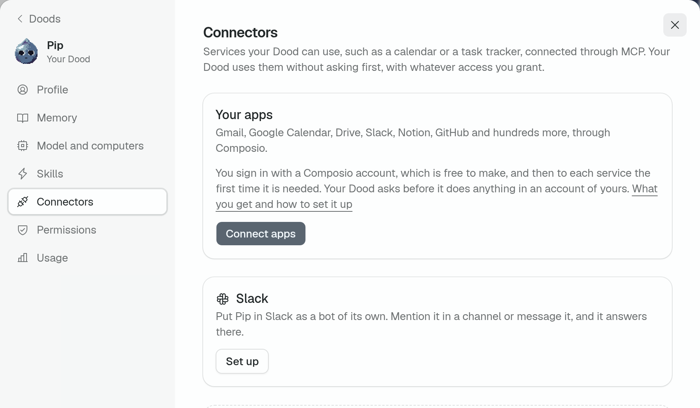
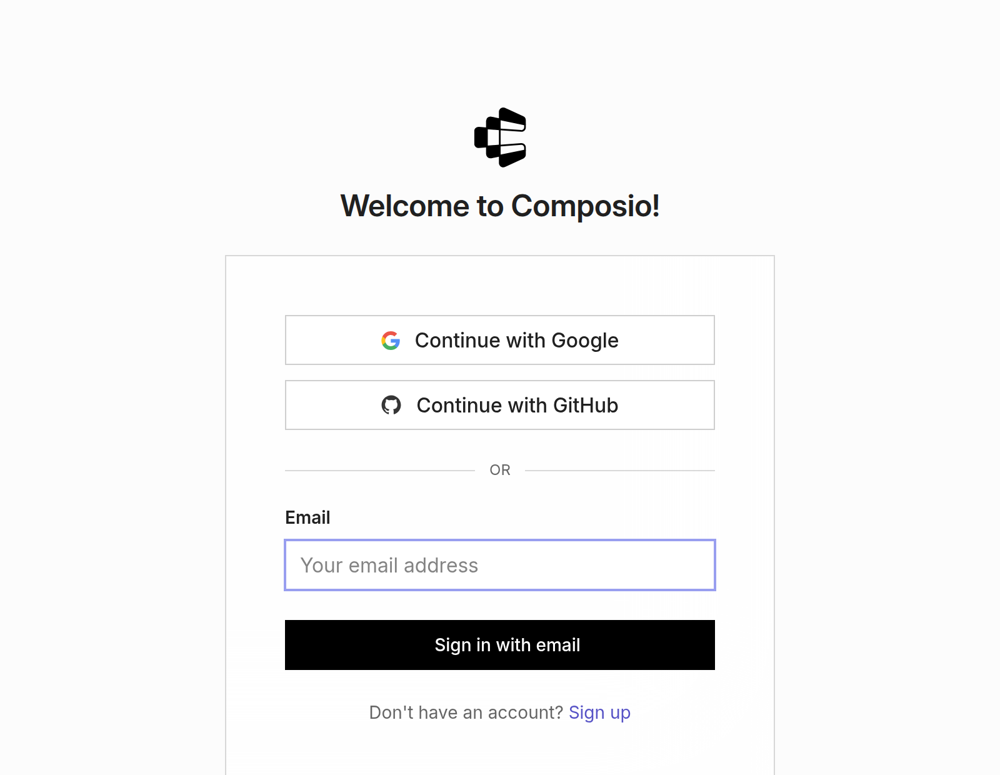
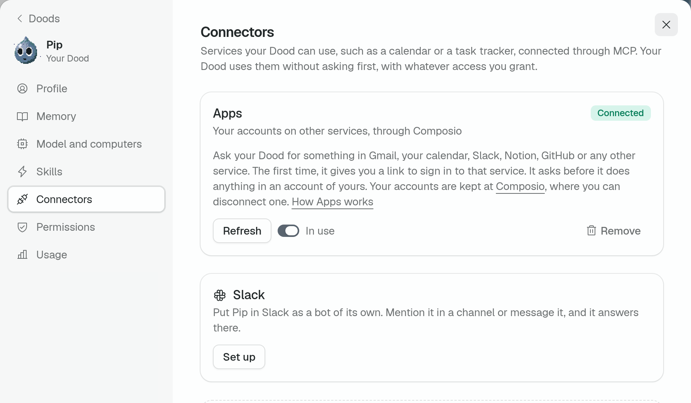
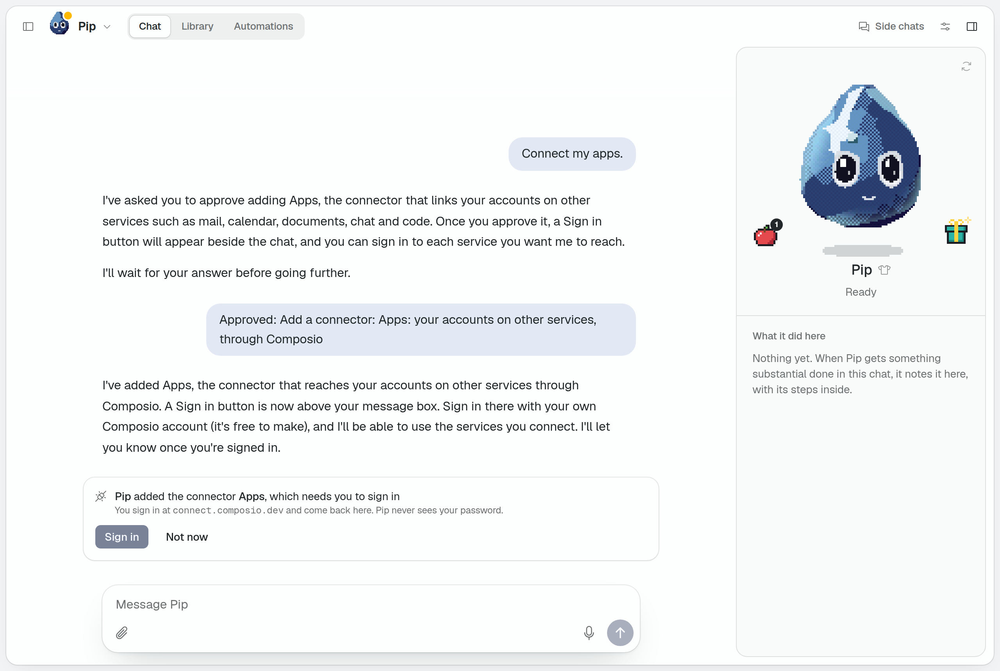
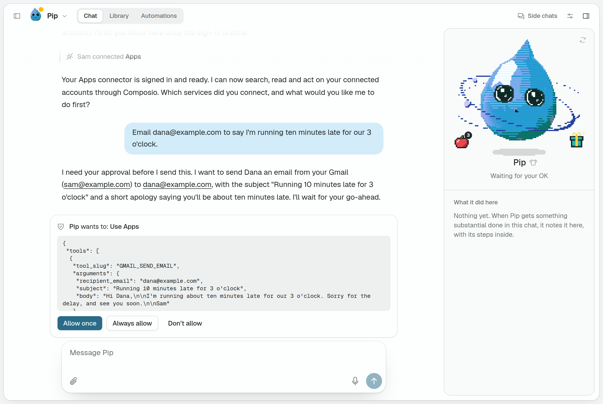

# Connect your apps

Let your Dood work in your own accounts: Gmail, Google Calendar, Drive, Slack, Notion, GitHub and hundreds more. It takes one button and a free account at Composio, and your Dood asks before it does anything in an account of yours.

> **If you are an agent** in Do Computer and someone gave you this page: add Apps with your `connectors` tool (`add_apps`), then wait for them to press Sign in. Never ask for a password or a key in the chat.

## What you get

On its own, your Dood has a computer and a memory, and nothing of yours. With Apps it reads and acts where your work already is:

- **Mail.** "Find the invoice Dana sent last week and tell me what it comes to." "Email Dana that I am running ten minutes late."
- **Calendar.** "What do I have tomorrow?" "Move my 2 o'clock to Friday and tell the others."
- **Documents.** "Summarize the launch plan in Notion." "Add last month's numbers to the budget sheet."
- **Chat and code.** "What did I miss in #design today?" "Which issues are assigned to me?"

You connect a service the first time you ask for something in it, so there is no list to work through first. [Composio](https://composio.dev) is the service that holds the connections: it has the sign-in for each service, and Do Computer reaches all of them through it.

## Why connect them

- **One sign-in covers everything.** Any other service is a connector of its own, with an address to find and a sign-in to do. Apps is one connector for all of them.
- **No keys.** You sign in on each service's own page. Your Dood never sees a password or a token.
- **It asks first.** Nothing is read, sent or changed in an account of yours until you say yes, with what it is about to do in front of you.
- **You can take it back.** Disconnect one service at Composio, or remove Apps from your Dood, whenever you like.
- **Nothing to set up on the server.** A deployment needs no key and no setting for this. It works the same on one you host yourself.

## Set it up

1. **Open your Dood's Connectors.** Open your Dood's settings, with the sliders button at the top of its chat, and choose **Connectors**. Under **Your apps**, press **Connect apps**.

   

2. **Sign in at Composio.** The page that opens is Composio's. Sign in with Google, GitHub or your email. If you have no account there, make one: it is free.

   

3. **Come back.** When you are done there, Composio sends you back to Do Computer.

   

   Check: the card is called **Apps** and says **Connected**.

4. **Ask for something.** Go back to the chat and ask for something in one of your accounts. The first time a task needs a service, your Dood gives you a link to sign in to that service. That page is Composio's too. Tell your Dood when you have signed in, because it is not told, and it carries on.

## Or ask your Dood

You can skip the settings. Say "Connect my apps", or just ask for something in one of your accounts. Your Dood asks to add a connector. Allow it, and a **Sign in** button appears above the message box. From there it is step 2 above.

## It asks before it acts

Apps starts on **Ask first**. Finding out which tools a service has, and making you a sign-in link, go ahead. Everything else waits for your answer, reading included, and you see exactly what would be run.

- **Allow once** lets this one thing go ahead.
- **Always allow** stops your Dood asking about Apps from then on.
- **Don't allow** tells your Dood no, and it carries on without it.

To change it later, open your Dood's settings and choose **Permissions**: the row **Use Apps** is set to **Ask first** or **Allow**. An automation follows the same rule and waits the same way, so one that should use your accounts while you are away needs Apps on Allow.

## What Composio holds

- **The grants you give.** When you sign in to Gmail or Slack through Apps, the grant is kept by Composio, in your account there. Do Computer keeps only its sign-in to your Composio account.
- **Every call.** What your Dood reads or does in a service passes through Composio on its way. Composio counts those calls against your account there, not against the deployment.
- **Nothing of your passwords.** You type them on the service's own page, not in Do Computer and not in the chat.

## In a team

- **Whose accounts.** Those of whoever signed in to Composio for that Dood. In a shared workspace that is one person's accounts for everyone who talks to the Dood, so connect them on a Dood only the right people use.
- **Each Dood is separate.** A second Dood has no Apps until someone connects it there too.
- **Who answers.** Anyone in the workspace can answer when the Dood asks.

## Disconnect

- **One service.** Sign in at [Composio](https://composio.dev) and disconnect it there.
- **For a while.** Switch **In use** off on the Apps card. Your Dood no longer has it until you switch it on.
- **All of it.** Press **Remove** on the Apps card. That takes away Do Computer's sign-in to your Composio account. Your account there, and the services connected to it, stay as they were until you disconnect them at Composio.

## When something goes wrong

- **The card says Needs sign-in.** The sign-in at Composio was not finished, or has run out. Press **Sign in** on the card.
- **The card says Not connected.** Composio could not be reached. Press **Try again**.
- **Your Dood says a service is not connected.** Ask it for the link again, sign in, and tell it you have.
- **It asks about everything.** That is Ask first. Press **Always allow** on a request, or set Apps to **Allow** under Permissions.
- **A scheduled run did nothing.** It is waiting for your OK. Answer it in the chat, or set Apps to **Allow**.
- **Your Dood does not offer to connect anything.** Ask it outright: "Connect my apps."
